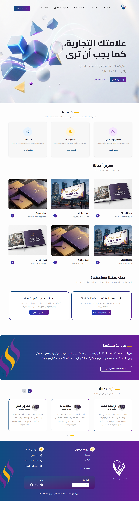
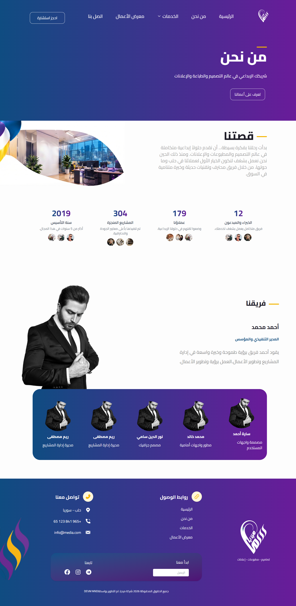
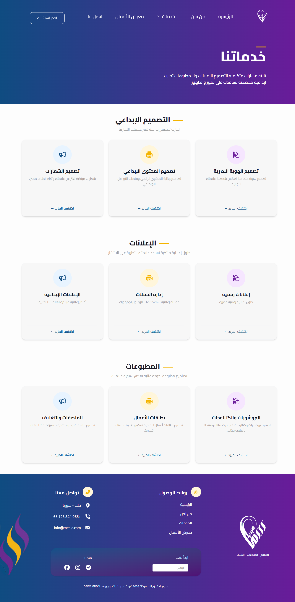
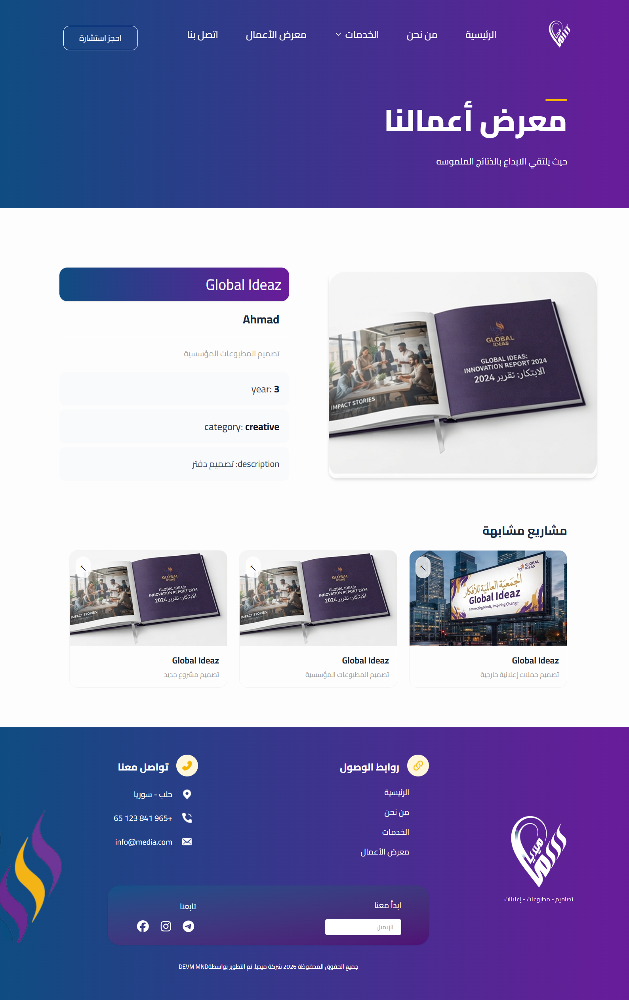
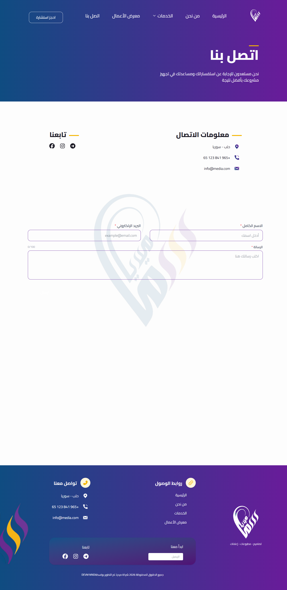
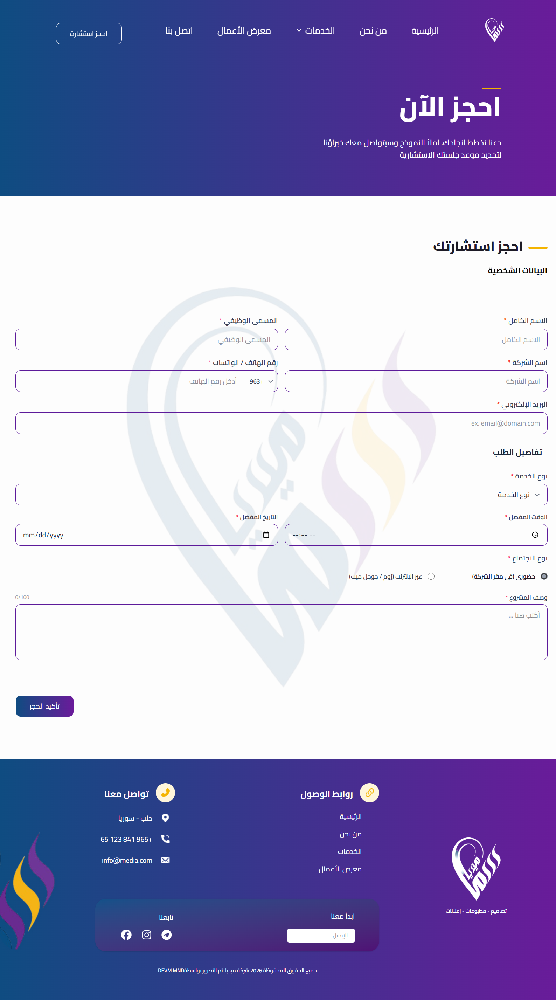

# Media Agency Web

## About The Project

Media Agency Web is a modern website for a media agency. It allows visitors to explore the agency, discover its services, view previous projects, and book a consultation.

The project is built using React and Vite, with a feature-based architecture to keep the code organized, reusable, and maintainable.

## Pages

The application includes the following pages:

| Page | Route | Description |
|---|---|---|
| Home | `/` | Main landing page |
| About | `/about` | Information about the agency |
| Services | `/services` | Agency services |
| Portfolio | `/PortfolioPage` | Previous projects |
| Project Details | `/portfolio/:projectId` | Details of a selected project |
| Contact | `/ContactPage` | Contact information |
| Booking | `/book-consultation` | Consultation booking |
| Not Found | `*` | Displayed for unknown routes |

## Screenshots

Screenshots of the main pages will be added here.

### Home Page


### About Page


### Services Page


### Portfolio Page


### Contact Page


### Booking Page


## Technologies Used

- React 19
- Vite
- JavaScript
- TypeScript
- Tailwind CSS
- React Router
- React Hook Form
- Zod
- i18next (multilingual support is still under development)

## Requirements

Before running the project, make sure you have:

- Node.js
- npm
- Git

## Installation

1. Clone the repository:

   ```bash
   git clone YOUR_REPOSITORY_URL
   ```

2. Navigate to the project directory:

   ```bash
   cd media-agency-web
   ```

3. Install dependencies:

   ```bash
   npm install
   ```

4. Start the development server:

   ```bash
   npm run dev
   ```

5. Open the local URL displayed in your terminal.

**Note:** The project currently works without a backend and does not require environment variables.

## Available Scripts

| Command | Description |
|---|---|
| `npm run dev` | Starts the development server |
| `npm run build` | Builds the project for production |
| `npm run lint` | Runs ESLint to check code quality |
| `npm run format` | Formats files using Prettier |
| `npm run preview` | Previews the production build |
| `npm test` | Runs Vitest. Test files have not been added yet. |

## Project Structure

The project follows a Feature-Based Architecture, where the code is organized according to application features.

```text
media-agency-web/
├── public/
├── src/
│   ├── assets/
│   ├── components/
│   │   ├── layout/
│   │   └── ui/
│   ├── features/
│   │   ├── home/
│   │   ├── about/
│   │   ├── services/
│   │   ├── portfolio/
│   │   ├── contact/
│   │   ├── booking/
│   │   └── NotFound/
│   ├── routes/
│   │   └── AppRoutes.tsx
│   ├── services/
│   ├── shared/
│   ├── locales/
│   ├── types/
│   └── App.jsx
├── package.json
└── README.md
```

### Architecture

The project uses Feature-Based Architecture.

Each feature has its own folder containing files related to that feature, such as pages and components.

The `components` folder contains reusable components:

- `layout/`: Shared layout components such as Navbar, Footer, and MainLayout.
- `ui/`: Reusable UI components such as Button, Card, Input, Select, and Textarea.

The `routes` folder contains the application routes and navigation logic.

### Naming Conventions

- Components and pages use PascalCase, such as `HomePage.tsx`.
- Utility files use camelCase.
- The main application file is `App.jsx`.

### Imports

The project currently uses relative import paths instead of aliases.

## Backend

The application currently works without a backend.

Backend integration may be added in a future development phase.

## Testing

Vitest is configured in the project through the `test` script.

Test files have not been created yet.

## Internationalization

The project includes a `locales` folder and i18next support.

Multilingual functionality is still under development.

## License

This project is currently under development.


For more details, see [Architecture Documentation](docs/architecture.md).